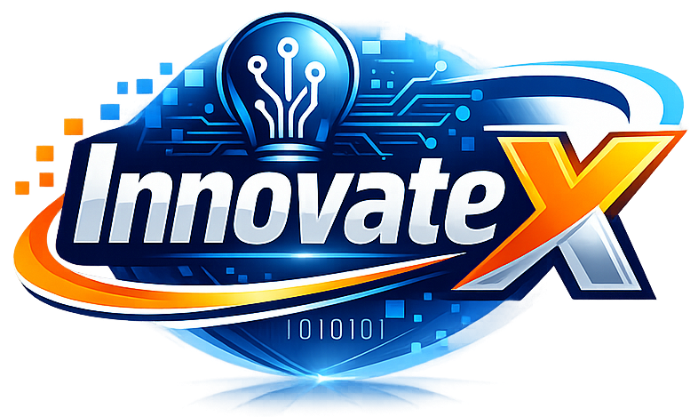

# InnovateX Promotional Website



## Project Overview

Promotional website for **InnovateX** — a software company developing interactive safety and wellness training solutions for the logistics and warehousing sector.

This website was created as part of **CET257 Enterprise Project — Assignment 2 (B2)** at the **University of Sunderland**.

**Live URL:** [https://innovatex-promotional-website.netlify.app](https://innovatex-promotional-website.netlify.app)

---

## Table of Contents

- [Team](#team)
- [Client](#client)
- [Pages](#pages)
- [Design System](#design-system)
- [Technologies Used](#technologies-used)
- [Corporate Identity](#corporate-identity)
- [Zero-Budget Marketing Plan](#zero-budget-marketing-plan)
- [How to Run Locally](#how-to-run-locally)
- [Folder Structure](#folder-structure)
- [Deployment](#deployment)
- [Module Details](#module-details)
- [Acknowledgements](#acknowledgements)

---

## Team

**InnovateX (Team 3)** — University of Sunderland (via ISMT College, Chitwan, Nepal)

| Member | Role |
|--------|------|
| Tika Ram Pokharel | Project Manager / Developer |
| Rashik Khanal | Deputy Project Manager / Communication & Technical Lead |
| Sophiya Chhetri | Research & Quality Analyst |
| Anjit Lamichhane | Presentation Lead |
| Rachit Lohani | ePortfolio Coordinator / UI Support |
| Smarika Poudel | Documentation Manager / Analyst |

---

## Client

**Kushal Bhurtel** — Logistics and Warehousing Organisation (Automotive Sector)

The client provided the initial brief, clarification document, and ongoing feedback throughout the project.

---

## Pages

The website consists of five pages:

| Page | File | Purpose |
|------|------|---------|
| Home | `index.html` | Introduces InnovateX, its mission, and its core solutions |
| About Us | `about.html` | Presents the company's background, mission, values, and team |
| Services | `services.html` | Describes the services InnovateX offers |
| Portfolio | `portfolio.html` | Showcases past projects and case studies |
| Contact Us | `contact.html` | Provides contact details, a form, and FAQ |

---

## Design System

### Colour Palette

| Colour | Hex Code | Purpose |
|--------|----------|---------|
| Deep Blue | `#0A2A5E` | Headers, footers, hero sections |
| Bright Blue | `#1E88E5` | Links, secondary buttons, icons |
| Orange | `#F57C00` | Primary buttons, highlights, CTAs |
| White | `#FFFFFF` | Main background, cards |
| Light Grey | `#F5F7FA` | Alternating section backgrounds |
| Dark Grey | `#333333` | Body text, paragraphs |
| Mid Grey | `#7A7A7A` | Supporting text, captions |
| Border Grey | `#E4E8EE` | Card borders, dividers |

### Typography

| Element | Font | Weight |
|---------|------|--------|
| Headings (h1–h4) | Montserrat | 700 / 600 |
| Body text | Roboto | 400 / 500 |
| Section labels | Montserrat | 600 |
| Navigation links | Montserrat | 500 |
| Buttons | Montserrat | 600 |

---

## Technologies Used

| Technology | Purpose |
|------------|---------|
| HTML5 | Structure and content |
| CSS3 | Styling, layout, and responsiveness |
| JavaScript (Vanilla) | Mobile menu, smooth scroll, form validation, dynamic heading |
| Google Fonts | Montserrat and Roboto typefaces |
| Inline SVG | Icons |
| Netlify | Hosting and deployment |

No frameworks or libraries were used. The site was built with vanilla HTML, CSS, and JavaScript to keep it lightweight and easy to maintain.

---

## Corporate Identity

### Logo
The InnovateX logo incorporates a stylised lightbulb icon integrated with circuit patterns, symbolising innovation and technological expertise. The word "Innovate" is rendered in bold blue and white gradient, while the letter "X" is accentuated in orange with a dynamic swoosh.

### Mission Statement
> InnovateX is dedicated to creating innovative software solutions that enhance safety and wellness in the workplace.

### Tagline
> Innovating Safety, Engaging Learning

### Company Theme
- **Blue:** Trust, professionalism, technological expertise
- **White:** Clarity, simplicity
- **Orange:** Energy, creativity, attention to key elements

---

## Zero-Budget Marketing Plan

The website is the company's primary marketing asset and supports the zero-budget strategy through:

| # | How the Website Supports Marketing |
|---|------------------------------------|
| 1 | Provides a professional online presence that establishes credibility |
| 2 | Communicates what InnovateX offers through the Services page |
| 3 | Encourages enquiries and demo requests through prominent CTAs |
| 4 | Demonstrates the team's capability through the Portfolio page |
| 5 | Is hosted on a free platform (Netlify), supporting the zero-budget approach |
| 6 | Is structured to support search engine visibility through keyword-rich content |

### Free Marketing Channels Used
- LinkedIn (company page, industry insights)
- Twitter/X (safety tips, project updates)
- Instagram (visual content, infographics)
- University networks (student groups, events)
- Email outreach (personalised introductions)
- Networking events (student business events, hackathons)
- Content marketing (LinkedIn articles, blog posts)
- SEO (keyword optimisation)
- Referrals (word-of-mouth recommendations)

---

## How to Run Locally

1. **Download or clone this repository**
   ```bash
   git clone https://github.com/rashik27/innovatex-promotional-website.git

2. Navigate to the folder
    cd innovatex-promotional-website

3. Open index.html in any modern web browser

    Double-click index.html, or

    Right-click → Open with → Your preferred browser

4. No build process or server required

    The website is static HTML/CSS/JS

    It works directly from the file system